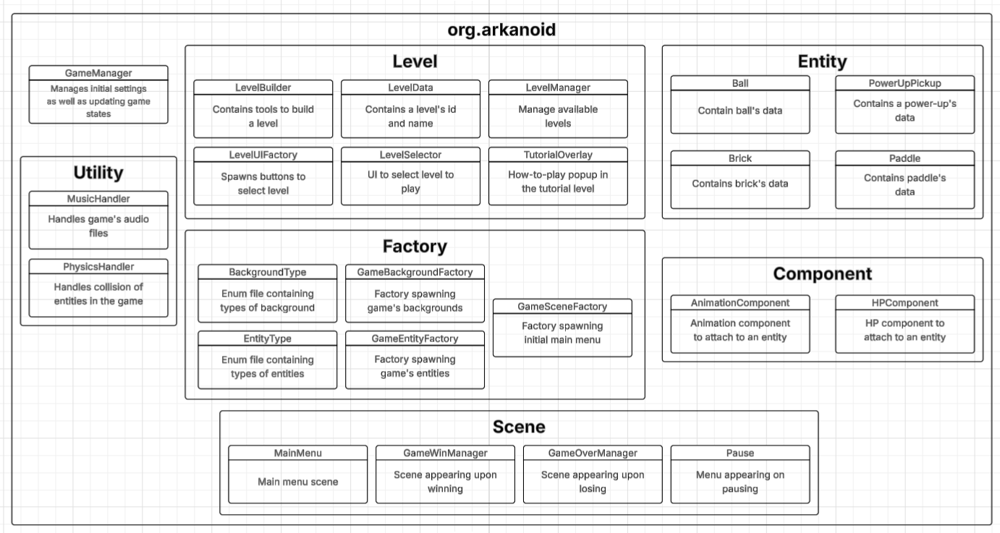

# Arkanoid

= [Video mô tả game](https://youtu.be/GSyWL5Tgyk8)

= Sơ đồ về files của game:

= Công việc thành viên:
- Nguyễn Hải An:
  + Created the initial framework (entities, factories, scenes,...).
  + Main merger, conflict resolver and refactorer.
  + Refined collison handling, MainMenu, PauseMenu and LevelBuilder.
  + Created the game's diagram and video showcase.
  + Creative director for game idea, sprites, SFXs and musics.
  + Wrote handlers for physics and musics.
  + Designed some levels.
  + Bug-fixing.
- Cao Khắc Phan Sang:
  + Created levels' main features: selector, manager, builder,...
  + Created the guide overlay in tutorial.
  + Created the base framework for MainMenu and GameOverManager, which subsequently also acts as the base for GameWinManager.
- Nguyễn Đức Khiêm:
  + Created components (animation and HP components).
  + Created the boss for the final level.
  + Found the game's backgrounds.
  + Wrote collision handling.
  + Bug-fixing.
- Bùi Hoàng Tùng:
  + Created power-ups for paddle and balls.
  + Wrote game variables and their UIs.
  + Designed some levels.
